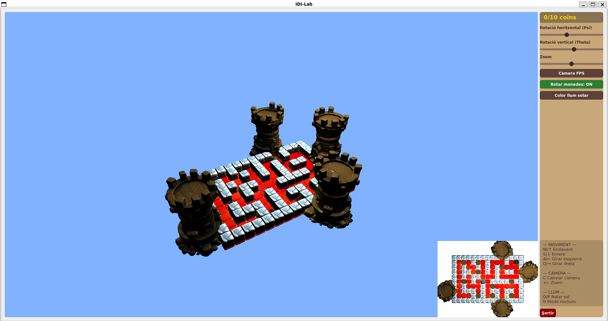
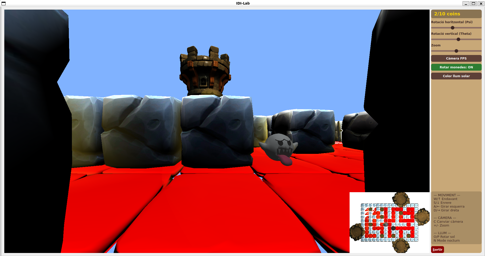
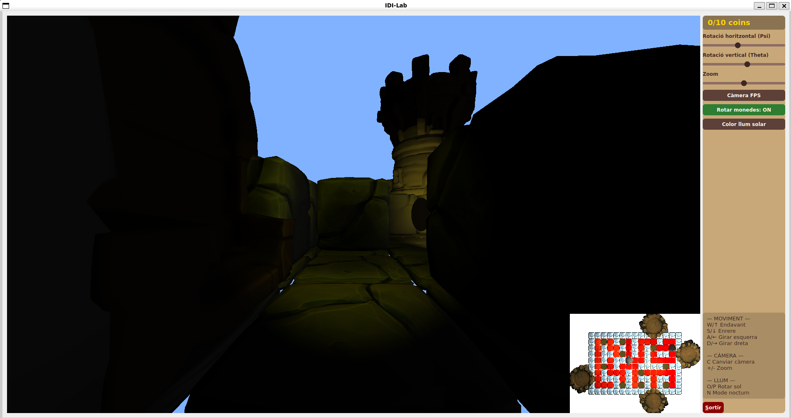

# INDI · Ghost in the Maze

**[English](#english) · [Català](#català)**




| First-person camera · Càmera en primera persona | Night mode · Mode nit |
|---|---|
|  |  |

---

## English

A 3D maze game built in C++ with Qt and OpenGL for the **INDI** course (Interaction and Interface Design, UPC, Q2 2025-2026).
You play as Morty: collect every coin in the maze and reach one of the exits, without running into the ghost that roams the corridors.

The project was developed **incrementally over the semester**, in 8 deliveries that added the scene, cameras, movement, interface, lighting and textures step by step.

### Features
- **Gameplay**: the maze is defined by an N×M matrix (walls, floor, start points, coins and exits). Grid-based movement, coin counter (`3/10 coins`), victory when all coins are collected and an exit is reached, and *game over* if the ghost touches you. **Start Game** resets the whole scene.
- **Ghost AI**: moves every time the player moves; it keeps going straight along corridors and picks a random free direction at intersections or dead ends.
- **Scene**: models are scaled automatically from their bounding boxes, and exit towers are placed and rotated next to each exit. The scene's bounding sphere is used to fit the camera, with no distortion when the window is resized.
- **Cameras**:
  - Third-person perspective view, with Euler-angle rotation (mouse or sliders) and zoom.
  - **First-person** view from Morty's head, which moves and turns with him.
  - Orthographic **minimap** in a second viewport.
- **Lighting** (fragment shader, Phong model):
  - A **sun** that moves along a meridian of the scene's bounding sphere, with a selectable colour.
  - **Night mode**: the sun turns off, Morty switches on a flashlight and the ghost carries its own light.
  - Every **coin** has a spotlight that rotates with it, with its range smoothly limited by a sigmoid.
- **Textures**: walls and towers loaded with Assimp and textured.
- **Qt interface**: Start Game button, coin counter, sliders for rotation and zoom (kept in sync with the mouse and keyboard), camera toggle, coin rotation on/off and sun colour.

### Controls
| Key / input | Action |
|---|---|
| `W` `A` `S` `D` / arrow keys | Move forward / turn left / move back / turn right |
| `C` | Switch between third-person and first-person camera |
| *Start Game* button | Start / restart the game (movement is locked until then) |
| `+` / `-` | Zoom in / out (third-person camera) |
| Left mouse drag | Rotate the camera |
| Right mouse drag | Zoom |
| `O` / `P` | Move the sun along its arc |
| `N` | Night mode (flashlight) |

### Tech stack
C++ · Qt 5 (`QOpenGLWidget`, Qt Designer UI) · OpenGL 3.3 Core · GLSL · GLM · Assimp

### Build
Requirements: Qt 5 with OpenGL support (`qmake`), a C++ compiler and `make`. GLM and Assimp are bundled in `glm/` and `assimp/`.

```bash
qmake Bloc2_Exemple.pro
make
./Bloc2_Exemple
```

> **3D models are not included.** The game loads its models (`Morty.obj`, `Coin.obj`, `Fantasma.obj`, `block.obj`, `tower.obj`) from a `../Models3D/` folder next to the project. They were provided by the course and are not redistributed here.

### Credits
Built on top of the skeleton code provided by the INDI course (base widget, model loader and Assimp helpers). The game logic, cameras, lighting, shaders and interface were developed for this project.

---

## Català

Joc de laberint en 3D fet en C++ amb Qt i OpenGL per a l'assignatura **INDI** (Interacció i Disseny d'Interfícies, UPC, Q2 2025-2026).
Jugues amb el Morty: has de recollir totes les monedes del laberint i arribar a una de les sortides sense topar amb el fantasma que es passeja pels passadissos.

El projecte s'ha desenvolupat **de manera incremental al llarg del quadrimestre**, en 8 lliuraments que han anat afegint l'escena, les càmeres, el moviment, la interfície, la il·luminació i les textures.

### Funcionalitats
- **Joc**: el laberint es defineix amb una matriu N×M (parets, terra, punts d'inici, monedes i sortides). Moviment per caselles, comptador de monedes (`3/10 coins`), victòria en recollir-les totes i arribar a una sortida, i *game over* si et toca el fantasma. **Start Game** reinicia tota l'escena.
- **IA del fantasma**: es mou cada cop que es mou el jugador; avança recte pels passadissos i tria una direcció lliure a l'atzar a les cruïlles o quan topa amb una paret.
- **Escena**: els models s'escalen automàticament a partir de la seva capsa contenidora, i les torres de sortida es col·loquen i s'orienten al costat de cada sortida. L'esfera contenidora de l'escena s'utilitza per ajustar la càmera, sense deformacions en redimensionar la finestra.
- **Càmeres**:
  - Vista en tercera persona en perspectiva, amb rotació per angles d'Euler (ratolí o lliscadors) i zoom.
  - Vista en **primera persona** des del cap del Morty, que es mou i gira amb ell.
  - **Minimapa** amb càmera ortogràfica en un segon viewport.
- **Il·luminació** (fragment shader, model de Phong):
  - Un **sol** que es mou per un meridià de l'esfera contenidora de l'escena, amb color seleccionable.
  - **Mode nit**: el sol s'apaga, el Morty encén una llanterna i el fantasma porta una llum a sobre.
  - Cada **moneda** té un focus que gira amb ella, amb l'abast limitat de forma suau amb una sigmoide.
- **Textures**: parets i torres carregades amb Assimp i texturitzades.
- **Interfície Qt**: botó Start Game, comptador de monedes, lliscadors de rotació i zoom (sincronitzats amb el ratolí i el teclat), canvi de càmera, activar/aturar el gir de les monedes i color del sol.

### Controls
| Tecla / entrada | Acció |
|---|---|
| `W` `A` `S` `D` / fletxes | Avançar / girar a l'esquerra / recular / girar a la dreta |
| `C` | Canviar entre càmera en tercera i en primera persona |
| Botó *Start Game* | Començar / reiniciar la partida (fins llavors no et pots moure) |
| `+` / `-` | Apropar / allunyar (càmera en tercera persona) |
| Arrossegar amb el botó esquerre | Rotar la càmera |
| Arrossegar amb el botó dret | Zoom |
| `O` / `P` | Moure el sol pel seu arc |
| `N` | Mode nit (llanterna) |

### Tecnologies
C++ · Qt 5 (`QOpenGLWidget`, interfície amb Qt Designer) · OpenGL 3.3 Core · GLSL · GLM · Assimp

### Compilació
Cal Qt 5 amb suport d'OpenGL (`qmake`), un compilador de C++ i `make`. GLM i Assimp ja són a les carpetes `glm/` i `assimp/`.

```bash
qmake Bloc2_Exemple.pro
make
./Bloc2_Exemple
```

> **Els models 3D no estan inclosos.** El joc carrega els models (`Morty.obj`, `Coin.obj`, `Fantasma.obj`, `block.obj`, `tower.obj`) des d'una carpeta `../Models3D/` al costat del projecte. Els va proporcionar l'assignatura i no es redistribueixen aquí.

### Crèdits
Fet a partir del codi esquelet de l'assignatura INDI (widget base, carregador de models i utilitats d'Assimp). La lògica del joc, les càmeres, la il·luminació, els shaders i la interfície s'han desenvolupat per a aquest projecte.

---

Llicència / License: [BSD 2-Clause](LICENSE)
